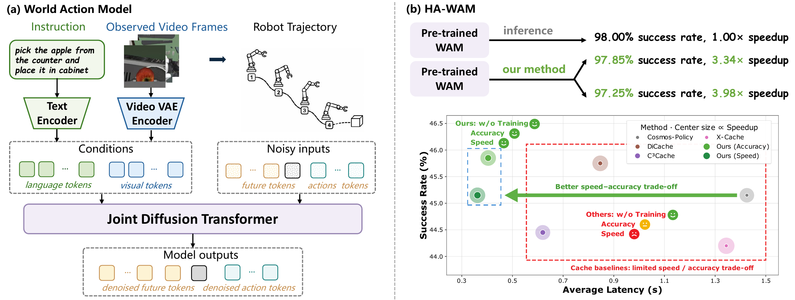

<div align="center">

# HA-WAM

### Training-Free Hierarchical Inference Acceleration for World Action Models

[Zengyuan Zuo](https://scholar.google.com/citations?hl=zh-CN&user=jb-4yJgAAAAJ)<sup>1,\*</sup>,[Yongchang Zhang]([https://scholar.google.com/citations?user=JSqb7QIAAAAJ](https://github.com/uuuuZYC))<sup>1,\*</sup>, [Yiwu Zhong](https://yiwuzhong.notion.site/homepage)

[VaLuE Lab](https://github.com/PKU-VaLuE-Lab), Peking University.

[]()
[]()

</div>

<!--
Project overview image placeholder.
Add the final figure here, for example:
<p align="center"></p>
-->

## Introduction

HA-WAM is an inference-time acceleration framework for world action models. It dynamically reduces redundant computation at three complementary levels:

- **Action-aware denoising-step skipping** routes simple action queries through fewer denoising steps and preserves full computation for harder motion.
- **Attention skipping** reuses stable self- and cross-attention computation inside the action DiT.
- **VAE reuse** detects visual changes independently for the primary and wrist views, then reuses unchanged image latents.

The current implementation is built on [Cosmos Policy](https://github.com/NVlabs/cosmos-policy) and includes evaluation support for **LIBERO**, **LIBERO-PRO**, and **RoboCasa**.

## Highlights

- Training-free, query-adaptive acceleration for pretrained world-action policies.
- Hierarchical reuse across denoising steps, attention modules, and visual encoding.
- Accuracy- and speed-oriented evaluation configurations.
- Camera-aware VAE gating with RGB and shallow-VAE feature options.
- Reproducible final launchers, ablations, and cache baselines for three benchmarks.

## Installation

HA-WAM follows the upstream Cosmos Policy environment and checkpoint setup. See the official documentation before running an evaluation:

- [Environment setup](https://github.com/NVlabs/cosmos-policy/blob/main/SETUP.md)
- [Cosmos Policy checkpoints and training data](https://huggingface.co/collections/nvidia/cosmos-policy)
- [LIBERO fine-tuning and evaluation](https://github.com/NVlabs/cosmos-policy/blob/main/LIBERO.md)
- [RoboCasa fine-tuning and evaluation](https://github.com/NVlabs/cosmos-policy/blob/main/ROBOCASA.md)

Model weights, benchmark datasets, simulator assets, local caches, and logs are intentionally excluded from this repository. Download them through the upstream instructions and set the corresponding checkpoint/cache paths for your machine.

## Evaluation

The final runners accept a GPU index and a benchmark selection. The examples below evaluate all suites/tasks with seed 195 defaults.

### LIBERO

```bash
# Cosmos-Policy baseline
bash libero_final/eval.sh --gpu 0 all

# HA-WAM: Action-Aware + Attention Skip + VAE Reuse
bash libero_final/eval_standard.sh --gpu 0 all
```

The accuracy/speed launch configurations and two-component ablations are provided under [`libero_final`](./cosmos-policy-final/libero_final).

### LIBERO-PRO

```bash
# Cosmos-Policy baseline
bash liberopro_final/eval.sh --gpu 0 all

# HA-WAM standard configuration
bash liberopro_final/eval_standard.sh --gpu 0 all
```

LIBERO-PRO perturbation evaluation, split 10,000-episode launchers, and feature-gate ablations are provided under [`liberopro_final`](./cosmos-policy-final/liberopro_final) and [`liberoproablation`](./cosmos-policy-final/liberoproablation).

### RoboCasa

```bash
# Cosmos-Policy baseline
bash robocasa_final/eval.sh all --gpu 0

# HA-WAM standard configuration
bash robocasa_final/eval_standard.sh all --gpu 0
```

### Cache baselines

DiCache, C³Cache, and X-Cache use the original policy inference path with their respective cache mechanisms:

```bash
# Replace libero_final with liberopro_final for LIBERO-PRO.
bash libero_final/eval_dicache.sh --gpu 0 all
bash libero_final/C3Cache.sh --gpu 0 all
bash libero_final/xcache.sh --gpu 0 all
```

> The protected multi-GPU launchers used for formal timing runs assume NVIDIA `EXCLUSIVE_PROCESS` mode and machine-specific service permissions. The single-evaluation commands above are the portable entry points.

## Project Structure

```text
cosmos-policy-final/
├── cosmos_policy/       # Cosmos Policy model and inference implementation
├── libero_final/        # LIBERO final configs, launchers, and baselines
├── liberopro_final/     # LIBERO-PRO final configs, launchers, and baselines
├── liberoproablation/   # LIBERO-PRO ablation launchers
├── robocasa_final/      # RoboCasa final configs and launchers
├── LIBERO-PRO/          # LIBERO-PRO benchmark integration
├── c3cache_runtime.py   # C³Cache runtime integration
└── xcache_runtime.py    # X-Cache runtime integration
```

## Citation

Paper and BibTeX will be added upon release.

```bibtex
% Coming soon.
```

## Acknowledgments

This project is built on [NVIDIA Cosmos Policy](https://github.com/NVlabs/cosmos-policy). We also thank the authors of [LIBERO](https://github.com/Lifelong-Robot-Learning/LIBERO), [LIBERO-PRO](https://github.com/Zxy-MLlab/LIBERO-PRO), and [RoboCasa](https://github.com/robocasa/robocasa) for their benchmarks and tools.

## License

Please follow the licenses and third-party attributions included in [`cosmos-policy-final`](./cosmos-policy-final/LICENSE) and [`ATTRIBUTIONS.md`](./cosmos-policy-final/ATTRIBUTIONS.md).
