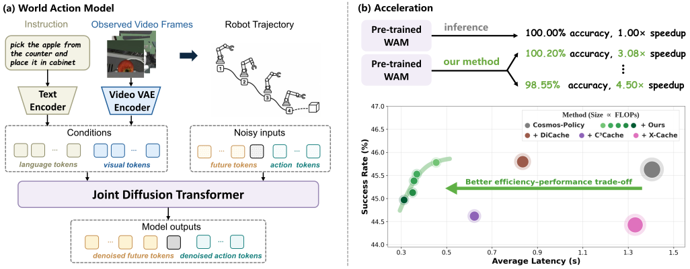

<div align="center">

<h1>Systematic Multi-Level Acceleration for<br>World Action Models</h1>

[Zengyuan Zuo](https://scholar.google.com/citations?hl=zh-CN&user=jb-4yJgAAAAJ)<sup>1,\*</sup>, [Yongchang Zhang](https://github.com/uuuuZYC)<sup>1,\*</sup>, [Guangyu Zhao](https://guangyu-zhao.github.io/)<sup>1</sup>, [Tianze Zhang](https://scholar.google.com/citations?user=TSzGqfAAAAAJ&hl=en)<sup>1</sup><br>
[Biao Wu](https://scholar.google.com/citations?user=Y3SBBWMAAAAJ&hl=en)<sup>2</sup>, [Meng Fang](https://mengfn.github.io/)<sup>3</sup>, [Yiwu Zhong](https://yiwuzhong.notion.site/homepage)<sup>1,†</sup>

<sup>1</sup>[VaLuE Lab](https://github.com/PKU-VaLuE-Lab), Peking University &nbsp;&nbsp;
<sup>2</sup>University of Technology Sydney &nbsp;&nbsp;
<sup>3</sup>University of Liverpool

*<b>Equal Contribution</b> <sup>†</sup><b>Corresponding Author</b>

[]()
[](https://harbinzzy.github.io/projects/mars.html)

</div>

<details><summary>📖 Click for the full abstract of our method</summary>

<div align="left">

> World Action Models (WAMs) are emerging as a promising alternative to Vision-Language-Action (VLA) models. Existing VLA acceleration methods primarily reduce VLM computation and are not directly applicable to diffusion-based WAMs. Moreover, WAM acceleration methods typically target redundancy along only a single computational axis, overlooking substantial redundancy across the full pipeline, resulting in either limited speedups or drops in success rate. To address these limitations, we propose **MARS**, a training-free multi-level acceleration framework that systematically exploits distinct sources of redundancy at three computational levels: (1) across Transformer blocks, we selectively skip redundant attention components; (2) across diffusion denoising steps, we perform action-aware routing to adaptively skip diffusion steps; (3) across consecutive action chunks, we reuse future visual tokens, thereby skipping the VAE encoding. These mechanisms are synergistically integrated in a plug-and-play manner. Extensive experiments across multiple benchmarks and base models demonstrate that our method achieves a superior efficiency-performance trade-off, delivering up to a 4.00×/3.94× speedup in LIBERO/LIBERO-PRO, 2.10× in RoboCasa, and consistent speedups on real-world tasks, while maintaining comparable success rates.
</details>
</div>

## 📚 Overview
<p align="center"></p>

If MARS is helpful to your projects, please help star this repo. Thank you! :point_left:

## 🌟 Introduction

Our method is an inference-time acceleration framework for world action models. It dynamically reduces redundant computation at three levels:

- **Selective Attention Skipping** skips low-impact self- and cross-attention computation within each denoising step.
- **Action-Aware Step Skipping** dynamically routes each query between one-step generation and residual-reuse multi-step sampling based on motion granularity, reducing redundancy across diffusion denoising steps.
- **Shallow-Verify Visual Token Reuse** verifies visual consistency using shallow VAE features and, when reliable, reuses predicted future visual tokens across consecutive action chunks.

## 🛠️ Installation

Clone the repository first:

```bash
git clone https://github.com/PKU-VaLuE-Lab/MARS.git
cd MARS
```

### Cosmos Policy

The primary MARS implementation follows the official Cosmos Policy Docker environment:

```bash
cd cosmos-policy-final
docker build -t cosmos-policy docker
```

Setup details, checkpoints, and fine-tuning recipes:

- [Environment setup](https://github.com/NVlabs/cosmos-policy/blob/main/SETUP.md)
- [Cosmos Policy checkpoints](https://huggingface.co/collections/nvidia/cosmos-policy)
- [LIBERO fine-tuning and evaluation](https://github.com/NVlabs/cosmos-policy/blob/main/LIBERO.md)
- [RoboCasa fine-tuning and evaluation](https://github.com/NVlabs/cosmos-policy/blob/main/ROBOCASA.md)

### OpenPI / π0.5

The OpenPI adaptation is stored in `openpi/` (including the final launchers in `openpi/openpi_final/`). Install [uv](https://docs.astral.sh/uv/getting-started/installation/), restore the two upstream example dependencies, and create the environment:

```bash
cd openpi
git clone https://github.com/Physical-Intelligence/aloha.git third_party/aloha
git clone https://github.com/Lifelong-Robot-Learning/LIBERO.git third_party/libero
GIT_LFS_SKIP_SMUDGE=1 uv sync
GIT_LFS_SKIP_SMUDGE=1 uv pip install -e .
```

See the included [OpenPI README](./openpi/README.md) for checkpoints and π0.5 fine-tuning.

### FastWAM

The FastWAM adaptation is stored in `FastWAM/`. Its upstream environment uses Python 3.10 and CUDA 12.8 builds of PyTorch:

```bash
cd FastWAM
conda create -n fastwam python=3.10 -y
conda activate fastwam
pip install -U pip
pip install torch==2.7.1+cu128 torchvision==0.22.1+cu128 --extra-index-url https://download.pytorch.org/whl/cu128
pip install -e .
```

See the included [FastWAM README](./FastWAM/README.md) for released checkpoints, datasets, and model preparation.

### LingBot-VA

```bash
cd lingbot-va
pip install -r requirements.txt
git clone https://github.com/Lifelong-Robot-Learning/LIBERO.git third_party/LIBERO
pip install -e third_party/LIBERO
```

See the included [LingBot-VA README](./lingbot-va/README.md) for the baseline and
accelerated evaluation commands. The released LingBot-VA checkpoint used here
is specific to LIBERO-LONG.

## 📊 Evaluation

### LIBERO

```bash
# Cosmos-Policy baseline
bash libero_final/eval.sh --gpu 0 all

# MARS standard configuration
bash libero_final/eval_standard.sh --gpu 0 all
```

### LIBERO-PRO

```bash
# Cosmos-Policy baseline
bash liberopro_final/eval.sh --gpu 0 all

# MARS standard configuration
bash liberopro_final/eval_standard.sh --gpu 0 all
```

### RoboCasa

```bash
# Cosmos-Policy baseline
bash robocasa_final/eval.sh all --gpu 0

# MARS standard configuration
bash robocasa_final/eval_standard.sh all --gpu 0
```

## 📈 Main Results

**Comparison with representative training-free acceleration methods on
[LIBERO](https://github.com/Lifelong-Robot-Learning/LIBERO) and
[LIBERO-PRO](https://github.com/Zxy-MLlab/LIBERO-PRO).** All acceleration
methods are adapted to the Cosmos&nbsp;Policy architecture for a fair comparison.

<table>
  <thead>
    <tr>
      <th>Method</th>
      <th>Goal</th>
      <th>Object</th>
      <th>Spatial</th>
      <th>Long</th>
      <th>Success&nbsp;Rate&nbsp;↑</th>
      <th>Speedup&nbsp;↑</th>
      <th>Latency&nbsp;↓</th>
      <th>FLOPs&nbsp;↓</th>
    </tr>
  </thead>
  <tbody>
    <tr><th colspan="9">LIBERO</th></tr>
    <tr><td>Cosmos&nbsp;Policy</td><td>98.20&nbsp;/&nbsp;1.00</td><td>99.87&nbsp;/&nbsp;1.00</td><td>97.47&nbsp;/&nbsp;1.00</td><td>96.67&nbsp;/&nbsp;1.00</td><td>98.05%</td><td>1.00×</td><td>1.4001&nbsp;s</td><td>100.00%</td></tr>
    <tr><td>+&nbsp;DiCache</td><td>98.07&nbsp;/&nbsp;1.70</td><td>99.87&nbsp;/&nbsp;1.66</td><td>97.80&nbsp;/&nbsp;1.67</td><td>97.27&nbsp;/&nbsp;1.72</td><td><strong>98.25%</strong></td><td>1.69×</td><td>0.8273&nbsp;s</td><td>48.12%</td></tr>
    <tr><td>+&nbsp;C<sup>3</sup>ache<sup>*</sup></td><td>97.80&nbsp;/&nbsp;2.19</td><td>99.00&nbsp;/&nbsp;2.16</td><td>97.53&nbsp;/&nbsp;2.25</td><td>94.47&nbsp;/&nbsp;2.30</td><td>97.20%</td><td>2.24×</td><td>0.6256&nbsp;s</td><td>33.18%</td></tr>
    <tr><td>+&nbsp;X&#8209;Cache<sup>*</sup></td><td>97.87&nbsp;/&nbsp;1.11</td><td>99.67&nbsp;/&nbsp;1.17</td><td>97.47&nbsp;/&nbsp;1.12</td><td>97.00&nbsp;/&nbsp;1.21</td><td>98.00%</td><td>1.17×</td><td>1.2017&nbsp;s</td><td>80.20%</td></tr>
    <tr><td><strong>+&nbsp;Ours&nbsp;(Speed)</strong></td><td>96.73&nbsp;/&nbsp;3.89</td><td>99.07&nbsp;/&nbsp;4.08</td><td>97.60&nbsp;/&nbsp;3.87</td><td>96.27&nbsp;/&nbsp;4.07</td><td>97.42%</td><td><strong>4.00×</strong></td><td><strong>0.3498&nbsp;s</strong></td><td><strong>18.39%</strong></td></tr>
    <tr><td><strong>+&nbsp;Ours&nbsp;(Acc.)</strong></td><td>98.47&nbsp;/&nbsp;3.06</td><td>99.60&nbsp;/&nbsp;3.29</td><td>97.80&nbsp;/&nbsp;3.10</td><td>96.60&nbsp;/&nbsp;3.19</td><td>98.12%</td><td>3.17×</td><td>0.4414&nbsp;s</td><td>19.19%</td></tr>
    <tr><th colspan="9">LIBERO&#8209;PRO</th></tr>
    <tr><td>Cosmos&nbsp;Policy</td><td>43.67&nbsp;/&nbsp;1.00</td><td>46.13&nbsp;/&nbsp;1.00</td><td>47.40&nbsp;/&nbsp;1.00</td><td>45.33&nbsp;/&nbsp;1.00</td><td>45.63%</td><td>1.00×</td><td>1.4044&nbsp;s</td><td>100.00%</td></tr>
    <tr><td>+&nbsp;DiCache</td><td>44.13&nbsp;/&nbsp;1.67</td><td>46.27&nbsp;/&nbsp;1.66</td><td>47.73&nbsp;/&nbsp;1.63</td><td>45.07&nbsp;/&nbsp;1.73</td><td><strong>45.80%</strong></td><td>1.68×</td><td>0.8347&nbsp;s</td><td>50.32%</td></tr>
    <tr><td>+&nbsp;C<sup>3</sup>ache<sup>*</sup></td><td>42.80&nbsp;/&nbsp;2.22</td><td>45.53&nbsp;/&nbsp;2.20</td><td>47.53&nbsp;/&nbsp;2.28</td><td>42.60&nbsp;/&nbsp;2.30</td><td>44.62%</td><td>2.26×</td><td>0.6222&nbsp;s</td><td>32.86%</td></tr>
    <tr><td>+&nbsp;X&#8209;Cache<sup>*</sup></td><td>43.73&nbsp;/&nbsp;1.17</td><td>46.20&nbsp;/&nbsp;1.22</td><td>47.80&nbsp;/&nbsp;1.17</td><td>44.33&nbsp;/&nbsp;1.26</td><td>45.52%</td><td>1.22×</td><td>1.1549&nbsp;s</td><td>75.55%</td></tr>
    <tr><td><strong>+&nbsp;Ours&nbsp;(Speed)</strong></td><td>44.20&nbsp;/&nbsp;3.91</td><td>45.67&nbsp;/&nbsp;3.86</td><td>47.33&nbsp;/&nbsp;3.96</td><td>44.93&nbsp;/&nbsp;3.99</td><td>45.53%</td><td><strong>3.94×</strong></td><td><strong>0.3564&nbsp;s</strong></td><td><strong>18.80%</strong></td></tr>
    <tr><td><strong>+&nbsp;Ours&nbsp;(Acc.)</strong></td><td>43.67&nbsp;/&nbsp;3.05</td><td>47.00&nbsp;/&nbsp;3.08</td><td>47.60&nbsp;/&nbsp;3.06</td><td>44.60&nbsp;/&nbsp;3.11</td><td>45.72%</td><td>3.08×</td><td>0.4558&nbsp;s</td><td>19.05%</td></tr>
  </tbody>
</table>

<sub><sup>*</sup> denotes our reimplementation due to unavailable official code.</sub>

**Evaluation on the [RoboCasa](https://github.com/robocasa/robocasa) benchmark.**

| Method | S.R.&nbsp;↑ | Speedup&nbsp;↑ | Latency&nbsp;↓ | FLOPs&nbsp;↓ |
|:--|--:|--:|--:|--:|
| Cosmos&nbsp;Policy | 66.69% | 1.00× | 2.2958&nbsp;s | 100.00% |
| +&nbsp;DiCache | 66.47% | 1.50× | 1.5305&nbsp;s | 49.99% |
| +&nbsp;C³ache<sup>*</sup> | 65.00% | 1.81× | 1.2653&nbsp;s | 33.64% |
| +&nbsp;X&#8209;Cache<sup>*</sup> | 66.37% | 1.20× | 1.9202&nbsp;s | 72.86% |
| +&nbsp;Falcon | 66.47% | 1.21× | 1.8968&nbsp;s | 74.56% |
| **+&nbsp;Ours** | **66.94%** | **2.10×** | **1.0911&nbsp;s** | **22.50%** |

**Our method with additional WAM and VLA base models on LIBERO.** LingBot&#8209;VA
can only be evaluated on Long, as only the Long checkpoint is publicly
available.

| Method | Goal | Object | Spatial | Long | Success&nbsp;Rate&nbsp;↑ | Speedup&nbsp;↑ | Latency&nbsp;↓ |
|:--|--:|--:|--:|--:|--:|--:|--:|
| Fast&#8209;WAM | 95.87&nbsp;/&nbsp;1.00 | 99.40&nbsp;/&nbsp;1.00 | 97.13&nbsp;/&nbsp;1.00 | 93.93&nbsp;/&nbsp;1.00 | **96.58%** | 1.00× | 0.5365&nbsp;s |
| **+&nbsp;Ours** | 96.07&nbsp;/&nbsp;3.43 | 99.00&nbsp;/&nbsp;3.25 | 96.93&nbsp;/&nbsp;3.43 | 93.20&nbsp;/&nbsp;2.93 | 96.30% | **3.17×** | **0.1693&nbsp;s** |
| LingBot&#8209;VA | -- | -- | -- | 97.40&nbsp;/&nbsp;1.00 | 97.40% | 1.00× | 13.4105&nbsp;s |
| **+&nbsp;Ours** | -- | -- | -- | 98.13&nbsp;/&nbsp;2.88 | **98.13%** | **2.88×** | **4.6558&nbsp;s** |
| π<sub>0.5</sub> | 97.80&nbsp;/&nbsp;1.00 | 98.67&nbsp;/&nbsp;1.00 | 98.40&nbsp;/&nbsp;1.00 | 92.93&nbsp;/&nbsp;1.00 | **96.95%** | 1.00× | 0.1462&nbsp;s |
| **+&nbsp;Ours** | 97.87&nbsp;/&nbsp;1.29 | 99.07&nbsp;/&nbsp;1.30 | 98.47&nbsp;/&nbsp;1.33 | 92.27&nbsp;/&nbsp;1.24 | 96.92% | **1.28×** | **0.1145&nbsp;s** |

## 📝 Citation

Paper and BibTeX will be added upon release.

```bibtex
% Coming soon.
```

## 🙏 Acknowledgments

This project is built on [NVIDIA Cosmos Policy](https://github.com/NVlabs/cosmos-policy). We also thank the authors of [Fast-WAM](https://yuantianyuan01.github.io/FastWAM/), [LingBot-VA](https://github.com/robbyant/lingbot-va), [OpenPI / π0.5](https://github.com/Physical-Intelligence/openpi), [LIBERO](https://github.com/Lifelong-Robot-Learning/LIBERO), [LIBERO-PRO](https://github.com/Zxy-MLlab/LIBERO-PRO), and [RoboCasa](https://github.com/robocasa/robocasa) for their models and benchmarks.

## 📮 Contact

Should you have any problems, please contact Zengyuan Zuo at [3565741165@qq.com](mailto:3565741165@qq.com). We will respond to your request as soon as possible!
