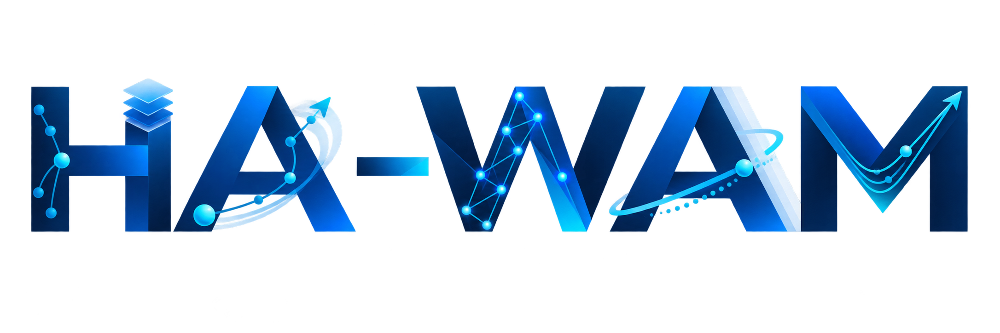

<div align="center">



### Training-Free Hierarchical Inference Acceleration for World Action Models

[Zengyuan Zuo](https://scholar.google.com/citations?hl=zh-CN&user=jb-4yJgAAAAJ)<sup>\*</sup>,[Yongchang Zhang](https://github.com/uuuuZYC)<sup>\*</sup>, [Yiwu Zhong](https://yiwuzhong.notion.site/homepage)<sup>†</sup>

[VaLuE Lab](https://github.com/PKU-VaLuE-Lab), Peking University.

[]()

</div>

## 📚 Overview
<p align="center"></p>

If HA-WAM is helpful to your projects, please help star this repo. Thank you! :point_left:

## 🌟 Introduction

HA-WAM is an inference-time acceleration framework for world action models. It dynamically reduces redundant computation at three complementary levels:

- **Action-Aware Diffusion Step Skip** routes coarse-grained action queries through fewer denoising steps and preserves full computation for fine-grained motion.
- **Redundancy-Aware Attention Skipping** reuses stable self- and cross-attention computation inside the action DiT.
- **Shallow-Verify Visual Token Reuse** detects visual changes independently for the primary and wrist views, then reuses unchanged image latents.

## Installation

Clone the repository first:

```bash
git clone https://github.com/Harbinzzy/HA-WAM.git
cd HA-WAM
```

### Cosmos Policy

The primary HA-WAM implementation follows the official Cosmos Policy Docker environment:

```bash
cd cosmos-policy-final
docker build -t cosmos-policy docker
```

Setup details, checkpoints, and fine-tuning recipes:

- [Environment setup](https://github.com/NVlabs/cosmos-policy/blob/main/SETUP.md)
- [Cosmos Policy checkpoints and training data](https://huggingface.co/collections/nvidia/cosmos-policy)
- [LIBERO fine-tuning and evaluation](https://github.com/NVlabs/cosmos-policy/blob/main/LIBERO.md)
- [RoboCasa fine-tuning and evaluation](https://github.com/NVlabs/cosmos-policy/blob/main/ROBOCASA.md)

### OpenPI / π0.5

The OpenPI adaptation is stored in `openpi/` (including the final launchers in `openpi/openpi_final/`). Install [uv](https://docs.astral.sh/uv/getting-started/installation/), restore the two upstream example dependencies, and create the environment:

```bash
cd openpi
git clone https://github.com/Physical-Intelligence/aloha.git third_party/aloha
git clone https://github.com/Lifelong-Robot-Learning/LIBERO.git third_party/libero
GIT_LFS_SKIP_SMUDGE=1 uv sync
GIT_LFS_SKIP_SMUDGE=1 uv pip install -e .
```

See the included [OpenPI README](./openpi/README.md) for checkpoints and π0.5 fine-tuning.

### FastWAM

The FastWAM adaptation is stored in `FastWAM/`. Its upstream environment uses Python 3.10 and CUDA 12.8 builds of PyTorch:

```bash
cd FastWAM
conda create -n fastwam python=3.10 -y
conda activate fastwam
pip install -U pip
pip install torch==2.7.1+cu128 torchvision==0.22.1+cu128 --extra-index-url https://download.pytorch.org/whl/cu128
pip install -e .
```

See the included [FastWAM README](./FastWAM/README.md) for released checkpoints, datasets, and model preparation.

Model weights, benchmark datasets, simulator assets, local caches, and logs are intentionally excluded from this repository. Download them through the upstream instructions and set the corresponding checkpoint/cache paths for your machine.

## Evaluation

### LIBERO

```bash
# Cosmos-Policy baseline
bash libero_final/eval.sh --gpu 0 all

# HA-WAM: Action-Aware + Attention Skip + VAE Reuse
bash libero_final/eval_standard.sh --gpu 0 all
```

### LIBERO-PRO

```bash
# Cosmos-Policy baseline
bash liberopro_final/eval.sh --gpu 0 all

# HA-WAM standard configuration
bash liberopro_final/eval_standard.sh --gpu 0 all
```

### RoboCasa

```bash
# Cosmos-Policy baseline
bash robocasa_final/eval.sh all --gpu 0

# HA-WAM standard configuration
bash robocasa_final/eval_standard.sh all --gpu 0
```

## Citation

Paper and BibTeX will be added upon release.

```bibtex
% Coming soon.
```

## Acknowledgments

This project is built on [NVIDIA Cosmos Policy](https://github.com/NVlabs/cosmos-policy). We also thank the authors of [LIBERO](https://github.com/Lifelong-Robot-Learning/LIBERO), [LIBERO-PRO](https://github.com/Zxy-MLlab/LIBERO-PRO), and [RoboCasa](https://github.com/robocasa/robocasa) for their benchmarks.

## License

Please follow the licenses included in [`cosmos-policy-final`](./cosmos-policy-final/LICENSE).
